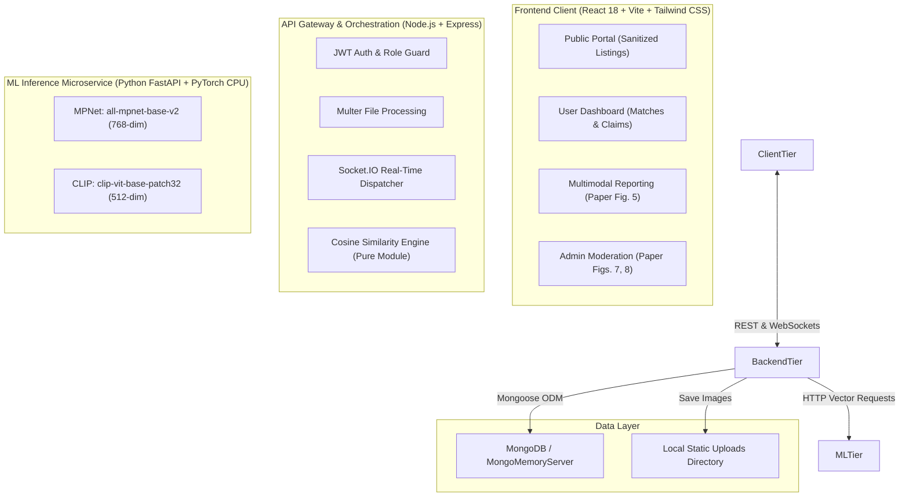

# AI-Based Multimodal Lost and Found System

[](file:///docs/REPORT.md)
[](file:///ml-service)
[](file:///server)
[](file:///client)

A production-grade, multimodal lost-and-found system for university campuses, municipal transit authorities, airports, and retail facilities. The system extracts dense semantic representations from item descriptions using **MPNet** and photographs using **CLIP ViT-B/32**, computes vector similarities in real time on standard CPU hardware, triggers instantaneous user alerts via **Socket.IO**, and provides private, verified claim workflows with administrative oversight.

---

## 1. System Architecture



---

## 2. Key Highlights & Features

- **Multimodal AI Matching**:
  - **Text Embeddings**: MPNet (`sentence-transformers/all-mpnet-base-v2`, 768-dim, mean-pooled and $L_2$ normalized).
  - **Visual Embeddings**: CLIP ViT-B/32 (`openai/clip-vit-base-patch32`, 512-dim, $L_2$ normalized).
  - **Cross-Modal Fallback**: Automatically compares text descriptions directly against photo embeddings when an asymmetric report is submitted.
- **Human-Designed Civic UI**:
  - Clean forest/emerald green and white palette matching IEEE paper Figures 5, 6, 7, and 8.
  - Zero AI glitter or neon gradient noise; accessible contrast, responsive down to 360px mobile width.
- **Privacy-First Architecture**:
  - Public listings redact and blur contact details.
  - Finder contact details are unlocked *only* after a high-confidence match ($\ge 0.75$) is established and a claim is initiated.
- **Demo-Ready Zero-Config Setup**:
  - Embedded `mongodb-memory-server` fallback boots automatically if no local MongoDB daemon is detected.
  - Seed script injects sample users, administrators, and 20 demo items with pre-computed embeddings.

---

## 3. Quick Start with Docker Compose

Run the entire platform (database, ML microservice, backend API, and frontend) with a single command:

```bash
docker compose up --build
```

- **Frontend Application**: [http://localhost:5173](http://localhost:5173)
- **Backend API**: [http://localhost:5000/api](http://localhost:5000/api)
- **ML Microservice Health**: [http://localhost:8000/health](http://localhost:8000/health)

---

## 4. Manual Local Setup (Step-by-Step)

### Prerequisites
- Node.js $\ge 18$ and npm
- Python $\ge 3.10$
- Windows, macOS, or Linux (CPU Intel i5 / 16 GB RAM friendly)

### 4.1 Step 1: Start ML Microservice
```bash
cd ml-service
python -m venv .venv

# Windows
.venv\Scripts\activate
# Linux/macOS
source .venv/bin/activate

# Install PyTorch CPU and dependencies
pip install --upgrade pip
pip install torch torchvision --index-url https://download.pytorch.org/whl/cpu
pip install -r requirements.txt

# Launch FastAPI on port 8000
uvicorn app.main:app --host 127.0.0.1 --port 8000
```

### 4.2 Step 2: Start Backend Server
```bash
cd server
npm install

# (Optional) Seed demo users, admin, and items
npm run seed

# Launch Express server on port 5000
npm start
```

### 4.3 Step 3: Start Frontend Client
```bash
cd client
npm install
npm run dev
```
Open [http://localhost:5173](http://localhost:5173) in your browser.

---

## 5. Pre-Seeded Demo Credentials

| Role | Email | Password | Purpose |
| :--- | :--- | :--- | :--- |
| **System Admin** | `admin@lostfound.local` | `AdminPass123!` | Moderate items, manage users, review audit log, inspect ML benchmarks |
| **User 1 (Owner)** | `user1@lostfound.local` | `UserPass123!` | Owns lost black wallet; receives match alerts and initiates claims |
| **User 2 (Finder)** | `user2@lostfound.local` | `UserPass123!` | Found black wallet; confirms claims and reveals contact details |
| **User 3** | `user3@lostfound.local` | `UserPass123!` | General student user with mixed items |

---

## 6. How Matching Works

The matching engine (`server/src/services/matchingEngine.js`) is an isolated, pure mathematical scoring unit:

1. **Category Prioritization**: Only queries items of opposite status (`lost` vs `found`). Evaluates same-category items first before broad fallback.
2. **Scoring Modes**:
   - **Text-Only**: $S = \text{Cosine}(\mathbf{v}_{t1}, \mathbf{v}_{t2})$
   - **Image-Only**: $S = \text{Cosine}(\mathbf{v}_{i1}, \mathbf{v}_{i2})$
   - **Hybrid**: $S = w_{\text{text}} \cdot S_t + w_{\text{img}} \cdot S_i$ (default: $0.50 / 0.50$)
   - **Cross-Modal**: $S = \text{Cosine}(\text{CLIP}_{\text{text}}(T), \text{CLIP}_{\text{vision}}(I))$
3. **Thresholds**:
   - $\ge 0.75$: **High Confidence Match** — Triggers immediate Socket.IO notification, creates persistent notification, unlocks private claim action.
   - $0.60 - 0.74$: **Possible Match** — Highlighted in the UI as recommended candidate for manual review.

---

## 7. Running the Academic Evaluation Benchmark

To reproduce the benchmark results reported in the IEEE paper:

```bash
# 1. Generate starter dataset (120 items: 40 text, 40 image, 40 hybrid)
python scripts/dataset/generate_starter_dataset.py

# 2. Run benchmark evaluation & generate charts
python scripts/evaluate/evaluate.py
```

Generated artifacts:
- Results JSON: `data/evaluation_results.json`
- Academic Markdown Report: `docs/REPORT.md`
- Visual Charts:
  - `data/accuracy_by_input_type.png` (accuracy across text, image, hybrid)
  - `data/confusion_matrix.png` (TP, FP, FN, TN heatmap)
  - `data/threshold_sweep.png` (precision/recall/F1 sweep curve)

---

## 8. API Reference Summary

| Method | Endpoint | Protection | Description |
| :--- | :--- | :--- | :--- |
| `POST` | `/api/auth/register` | Public | Register new user |
| `POST` | `/api/auth/login` | Public | Log in and receive 7-day JWT token |
| `GET` | `/api/auth/me` | User | Fetch current authenticated profile |
| `POST` | `/api/items` | User | Report lost or found item (multipart upload) |
| `GET` | `/api/items` | Public | List public items with masked contact details |
| `GET` | `/api/items/my` | User | List user's reported items with match counts |
| `GET` | `/api/items/:id/matches` | Owner / Admin | List top-K match candidates |
| `POST` | `/api/matches/:id/claim` | Owner | Submit claim ("This is mine") |
| `POST` | `/api/matches/:id/confirm` | Finder | Confirm claim (marks both items returned) |
| `GET` | `/api/admin/stats` | Admin | Dashboard metrics (users, items, matches) |
| `GET` | `/api/admin/items` | Admin | Item moderation list |
| `PUT` | `/api/admin/items/:id/moderation`| Admin | Approve or reject item |
| `GET` | `/api/admin/users` | Admin | User management with valid join dates |
| `PUT` | `/api/admin/users/:id/status`| Admin | Enable or disable user account |
| `GET` | `/api/admin/audit-logs` | Admin | Immutable admin activity trail |
| `GET` | `/api/admin/model-performance`| Admin | Live benchmark metrics and paper comparison |

Complete specifications are available in [docs/openapi.yaml](file:///docs/openapi.yaml) and [docs/postman_collection.json](file:///docs/postman_collection.json).

---

## 9. Troubleshooting & FAQ

1. **MongoDB is not installed on my host machine:**
   - No problem! The backend automatically detects the absence of an external MongoDB server and launches an embedded `mongodb-memory-server` in the workspace directory.
2. **Port 5000, 5173, or 8000 is already in use:**
   - Change the port in `.env` or set environment variables: `PORT=5001 npm start`.
3. **ML Microservice takes 15 seconds to respond on first launch:**
   - On initial process startup, Hugging Face caches the MPNet and CLIP model weights locally. Subsequent queries execute in under 150 ms on CPU.
