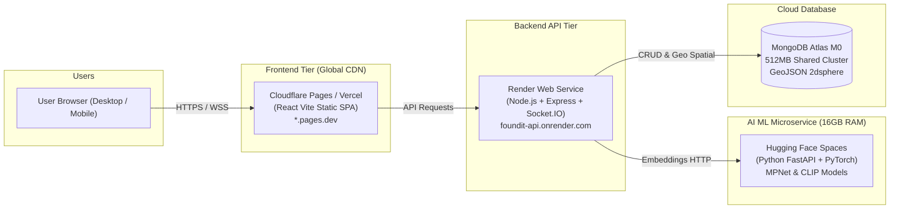

# FoundIT — Production Cloud Deployment Guide (100% Docker-Free)

This guide walks you through deploying the complete **FoundIT Multimodal AI Lost and Found System** to production using 100% free cloud services.



---

## Architecture & Service Directory

| Tier | Service | Free Plan Limits | Deployment Time |
| :--- | :--- | :--- | :--- |
| **Database** | [MongoDB Atlas](https://www.mongodb.com/cloud/atlas) | 512 MB storage, shared RAM, free forever | ~3 minutes |
| **ML Microservice** | [Hugging Face Spaces](https://huggingface.co/spaces) | 2 vCPU, **16 GB RAM**, free forever | ~5 minutes |
| **Backend API** | [Render](https://render.com) | Free Web Service (Node.js runtime) | ~4 minutes |
| **Frontend** | [Cloudflare Pages](https://pages.cloudflare.com) or [Vercel](https://vercel.com) | Unlimited bandwidth / global CDN | ~2 minutes |

---

## Step 1: Database Setup (MongoDB Atlas)

1. Sign up or log in at **[mongodb.com/cloud/atlas](https://www.mongodb.com/cloud/atlas)**.
2. Click **Create a Deployment** and select the **M0 Free** cluster (AWS, choose closest region like Mumbai `ap-south-1` or US East).
3. Under **Security > Database Access**:
   - Create a database user (e.g. `foundit_admin`) with a strong password.
4. Under **Security > Network Access**:
   - Click **Add IP Address** -> Select **Allow Access from Anywhere (`0.0.0.0/0`)** so your Render backend can connect.
5. Under **Database Deployments**:
   - Click **Connect** > **Drivers** (Node.js).
   - Copy your connection string. It will look like:
     ```
     mongodb+srv://foundit_admin:<password>@cluster0.abcde.mongodb.net/lostfound?retryWrites=true&w=majority
     ```
   *(Keep this string handy for Step 3).*

---

## Step 2: Deploy ML Microservice (Hugging Face Spaces)

Hugging Face Spaces provides a dedicated **2 vCPU / 16 GB RAM** container at zero cost, which is ideal for hosting PyTorch and loading MPNet + CLIP models.

### Deploying via Hugging Face Spaces:
1. Log in to **[huggingface.co](https://huggingface.co)** and go to **[huggingface.co/new-space](https://huggingface.co/new-space)**.
2. Fill in the details:
   - **Space name**: `foundit-ml`
   - **License**: `mit`
   - **Select the Space SDK**: Choose **Docker** (or **Blank**).
   - **Space hardware**: `CPU Basic · 2 vCPU · 16 GB RAM · Free`.
3. Push the files inside the `/ml-service` folder to your new Space repository:
   ```bash
   cd ml-service
   git init
   git remote add space https://huggingface.co/spaces/<your-username>/foundit-ml
   git add .
   git commit -m "Deploy FoundIT ML Microservice"
   git push space main --force
   ```
4. Once built (usually 2–3 minutes), Hugging Face gives you a public Direct URL:
   `https://<your-username>-foundit-ml.hf.space`
5. Verify it is running by visiting:
   `https://<your-username>-foundit-ml.hf.space/health`
   *(It will return `{"status":"healthy","device":"cpu",...}`)*

> [!TIP]
> **Alternative (Render Python)**: You can also deploy `/ml-service` on Render as a **Web Service** with runtime `Python 3`, build command `pip install -r requirements.txt`, and start command `uvicorn app.main:app --host 0.0.0.0 --port $PORT`.

---

## Step 3: Deploy Backend API (Render)

1. Sign up or log in at **[dashboard.render.com](https://dashboard.render.com)**.
2. Click **New +** > **Web Service**.
3. Connect your GitHub repository (or public Git repo URL).
4. Configure the service settings:
   - **Name**: `foundit-backend`
   - **Root Directory**: `server`
   - **Runtime**: `Node`
   - **Build Command**: `npm install`
   - **Start Command**: `npm start`
   - **Plan**: `Free`
5. Click **Advanced > Environment Variables** and add:
   | Key | Value | Notes |
   | :--- | :--- | :--- |
   | `NODE_ENV` | `production` | Enables production optimizations |
   | `MONGODB_URI` | `mongodb+srv://...` | Connection string from Step 1 |
   | `ML_SERVICE_URL` | `https://<your-username>-foundit-ml.hf.space` | URL from Step 2 |
   | `JWT_SECRET` | `your-secure-random-jwt-key-min-32-chars` | Auth token secret |
   | `CLIENT_URL` | `*` | Or your Cloudflare Pages domain from Step 4 |
6. Click **Create Web Service**.
7. Once deployed, Render provides your live API endpoint:
   `https://foundit-backend.onrender.com`
8. Verify by opening:
   `https://foundit-backend.onrender.com/api/health`

#### Seeding Initial Data:
In Render's dashboard for your service, click the **Shell** tab and run:
```bash
npm run seed
```
This populates your MongoDB Atlas database with 20 realistic Lost & Found benchmark items with GPS coordinates and images!

---

## Step 4: Deploy Frontend (Cloudflare Pages or Vercel)

### Option 4A: Cloudflare Pages (Recommended)
1. Go to **[dash.cloudflare.com](https://dash.cloudflare.com)**.
2. In the left navigation, go to **Compute (Workers) > Pages**.
3. Click **Connect to Git** and authorize your GitHub repository.
4. Set up the build configuration:
   - **Project name**: `foundit`
   - **Framework preset**: `Vite`
   - **Root directory**: `client`
   - **Build command**: `npm run build`
   - **Build output directory**: `dist`
5. Expand **Environment variables** and add:
   - `VITE_API_URL` = `https://foundit-backend.onrender.com/api`
6. Click **Save and Deploy**.
7. Cloudflare Pages builds in ~45 seconds and gives you a global URL:
   `https://foundit.pages.dev`

---

### Option 4B: Vercel (Alternative)
1. Go to **[vercel.com](https://vercel.com)** and click **Add New... > Project**.
2. Select your repository.
3. In **Root Directory**, click edit and select `client`.
4. Under **Environment Variables**:
   - `VITE_API_URL` = `https://foundit-backend.onrender.com/api`
5. Click **Deploy**. Vercel gives you `https://<your-app>.vercel.app`.

---

## Step 5: Verification Checklist

Once all services are deployed, test your live production application:

- [ ] **Home Page**: Open your `*.pages.dev` or `*.vercel.app` site. Notice cards and live stats load.
- [ ] **Map Explorer**: Click the `[ 🗺 Map Explorer ]` toggle on the Home page. Confirm OpenStreetMap tiles load with color-coded pins.
- [ ] **Report Lost**: Navigate to `/upload?type=lost`. Click *"Use my current location"* to verify browser GPS detects your coordinates.
- [ ] **Report Found**: Upload a photo with a description and submit.
- [ ] **Match Engine**: Open any item detail page (`/item/:id`). Check that the AI + Proximity match scores (0–100%) and candidate comparisons appear.
- [ ] **Admin Panel**: Visit `/admin/login` and log in with `admin@lostfound.local` / `AdminPass123!`.
